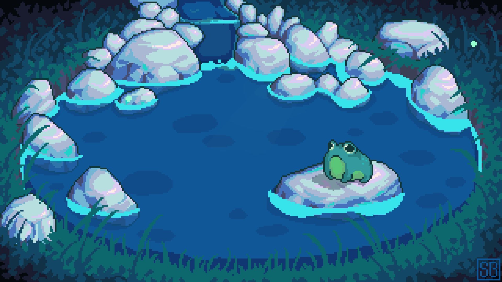

# Guilherme Caetano Lima

**`Software Engineering Student | IT Technician for the Web | Software Developer`**

Sou estudante de **Engenharia de Software** na **UMC** e **Técnico em Informática para a Internet** pela **ETEC de Poá**. Sou movido pela curiosidade técnica e pelo desafio de transformar lógica em aplicações funcionais. Atualmente, estou dedicado ao aprimoramento das minhas bases em desenvolvimento web e lógica de programação, buscando integrar o conhecimento acadêmico com a criação de interfaces modernas e eficientes. Meu foco está em evoluir na construção de sites e softwares e em boas práticas de código.

I'm a **Software Engineering** student at **UMC** and an **IT Technician for the Web** graduated from **ETEC Poá**. Driven by technical curiosity and the challenge of turning logic into functional applications. Currently, I'm dedicated to strengthening my foundations in web development and programming logic, seeking to integrate academic knowledge with the creation of modern and efficient interfaces. My focus lies in evolving my web and software development skills and following best practices.

   &nbsp;
   &nbsp;
  

 

## Tecnologias | Technologies

  
  
  
  
  
  
  
  
  

 

 
 
 

• Header artwork by <a href="https://x.com/scrunchybean">@scrunchybean</a>

